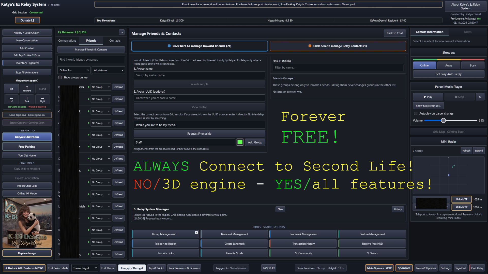
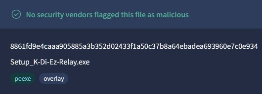

<div align="center">

### **Katya's Ez Relay System - Beta 1.0 - START FOR FREE - FOREVER FREE.**



**All versions come with the feature to keep recent chat conversations available, even after you crash or close the program. Never lose a customer or a new friend anymore because of a system crash or disconnect.** 

Forever Free: Start immediately without registration or a K-Di account. No connection to K-Di servers needed!
Registered Free: Free registration, enhanced features and access to optional Premium Unlocks, Licenses and other Ez features.
Pro: Additional advanced communication, organization and business tools. Turns Ez Relay Chat tool into a business management tool.

Katya's Ez Relay System is a lightweight Windows communication, organization and management tool for Second Life. It actually connects you directly to Second Life and allows you to use Second Life while adding enhanced features not available in the regular Second Life viewer. Katya's Ez Relay system is being developed for people already familiar with Second Life and those looking for a tool to stay connected as much as possible, not just to chat with friends but also to manage their business. Katya's Ez Relay is basically an enhanced Second Life viewer without the 3D graphics. Katya's Ez Relay System makes it possible to stay in Second Life while running heavy applications, games, secondary accounts (in combination with a normal viewer) without using as much CPU/GPU load. Another benefit is that people with very low end systems can still enjoy Second Life and to accommodate these people some more, I have opened a free chatroom (I might add more if people use it). To make this even more lightweight (right now, it uses your web-browser), a standalone version and Android version are planned in the near future when all the current planned implementations have been added and working properly.

Developed by K-Di Designs for Second Life, designed to comply with Linden Lab's Third-Party Viewer Policy.

Katya's Ez Relay System uses a local (on your own device) login component to authenticate with Second Life. Your login info is only sent from your device to Linden Lab's servers. All your chats (and logs) are strictly limited to go through your own system and Linden Lab's servers and never shared with K-Di servers (make sure to keep backups if you have important logs).  For security reasons, direct L$ transactions between avatars are limited. For example: paying someone's profile or someone else's owned objects is not possible. NOTE: Only because transactions are limited (except with K-Di Designs) does not mean that your store will stop working. Anything you have setup with your normal 3D viewer (including refund scripts) will work and you can still receive L$ and even see your balance. It's not possible to send L$ to other avatars while using Katya's Ez Relay System. Not sure if I will enable this as I like to focus on security but this all depends on what other people prefer. 

I'm looking forward to further developing this project using your feedback. Reminder: Ez Relay currently runs in your web browser with local services handling its Second Life connection. If you already have a web-browser open while launching Katya's Ez Relay and it seems like nothing happened... Check the tabs in your web-browser! :).

**Please watch the YouTube video for a quick overview of features (not everything is covered), and the registration process.**

https://youtu.be/hKvbGzQ2Ssg

### **The current beta has quite some features already. Just to name a few that you might expect from a viewer are already functional (including enhanced features):**

_Private messaging, Nearby Chat, and locally saved chat history. Second Life Friends and separate, customizable Relay Contacts. Resident profiles, friendship requests, and contact organization. Teleportation, favorite locations, and SLurls. Notecards, landmarks, textures, and supported inventory management. Second Life Groups, Group Chat, and Group Notices. Avatar controls, status, and L$ information. Optional Mini Radar with nearby resident information. Profile and Picks editing. Business-oriented contact and transaction-history tools. Themes, personalization, and convenient quick actions._

### **Next on the list (some already being tested):**

_Some common features that were almost ready (update asap). Some unique features I will announce later. Grid Map. Grid Map Search & Teleport. Search Second Life Groups. Public group-title switching. Expanded Avatar Movement Controls. Encrypt & Decrypt chat & transaction Logs. Advanced Inventory Organizer. Advanced inventory moving and sorting. Inventory cleaning rules and timelines. Land Management. Estate Management. Offline IM Mode and email integrations. Improved and enhanced media streaming. Upload images/textures. Uploading of building materials (such as mesh). Expanded Grid Compatibility (maybe). Dedicated standalone desktop app. Android Edition._

**_Microsoft might give you a pop-up the first time you run the installer/program because its not digitally signed.
Microsoft might ask if you trust this program from an unknown publisher._**

Checksum is some added security to make sure you are using the original setup file that came with this release.    
Current Beta 1.0 checksum (See YouTube video if you're not sure what to do with it):

 ```
8861fd9e4caaa905885a3b352d02433f1a50c37b8a64ebadea693960e7c0e934
```
Quick-tip: Make sure to only download Katya's Ez Relay System from my official GitHub page and upload your downloaded setup file to www.virustotal.com to check if the checksum matches and to scan the file. VirusTotal is owned by Google and uses up to roughly 60-70 known virus/malware scanners that all scan the file at the same time.



To register your free account (which you can upgrade and already comes with some upgrades) please look-up Katya Dirval in-world for a teleport. Registration with the avatar you wish to use is required if you wish to get the most out of Katya's Ez Relay System. You can register using the download/registration terminal at K-Di Designs. Registration is not needed if you decide to go with the 'Forever Free' plan. You can always register later or not at all, so, feel free if you simply want to mess around with Katya's Ez Relay System or stay on 'Forever Free' if the current basic functions are good enough for you. I do recommend checking back for updates every now and then, especially during the beta phase.   

**Direct download can be found underneath this page in the "Assets" section.**

**Direct DL: https://github.com/KatyaDirval/K-Di-Ez-Relay-Beta-1_0/releases/download/Beta-1.0/Setup_K-Di-Ez-Relay.exe**

_**More info & Downloads: https://github.com/KatyaDirval/K-Di-Ez-Relay-Beta-1_0/releases**_

**Katya’s Ez Relay System: Beta 1.1 Planned Updates & Fixes (will be released in following days):

Saved Avatar Licenses: Able to Select previously used avatars at startup and safely remove saved licenses.
World Map: Implemented region search, navigation, teleport and SLURL copying. Available to all plans, including Forever Free.
Profiles: Fix shortened biographies and prevent accidental truncation.
Group Chats: Display group conversations separately from direct IMs, together with group label.
Label Colors: Expanded to 24 colors.
Night Theme: Correct inconsistent colors in group-related fields.
Day Theme: Redesign with neutral light colors and improved readability.
Parcel Music: Add extra streaming URL/IP privacy warning.
Export Chat Logs: Fixed a bug and added 'Save As' allowing filename creation.
Auto-Reply: added an additional feature with auto-reply in group-chat (when first added).

View Profile: Added buttons to add friend, teleport and Relay contact actions.
Chat Logging: Irrelevant system messages are no longer logged.
Inventory Organizer: Fixed spacing between one of the buttons.
Conference Messages: Prevent confusion between conference sessions and group chats.
Notecard Editor: Support inserting actual inventory items, starting with landmarks and textures.
Busy Mode: Reworded the visible “Unavailable” wording in-world with “In Busy-Mode”.**

_Moved to 1.2 update:

Image/Texture Upload: Preview, permissions, accurate upload pricing. -- I have to check how to properly implement this, Prices might also be different for people on different Second Life premium plans._

========

_Katya's Ez Relay System is independently developed by K-Di Designs. This software is not provided or supported by Linden Lab, the makers of Second Life. More licensing info can be found after installation in the /docs folder and in the 'about' sections inside the application itself._

//Kat

</div>
